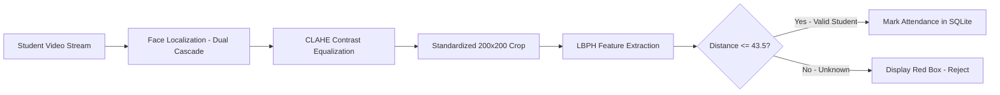

# ITM SLS BARODA UNIVERSITY, VADODARA
## **JavaScript Framework (PBL) - C2620A3 | BTech Semester 6 (2026–27)**
### **Project Synopsis: Smart College Attendance System with Face Recognition**

---

### **1. Candidate & Project Details**
- **Project Title**: Smart College Attendance System with Face Recognition
- **Course**: JavaScript Framework (PBL) - C2620A3
- **Group Code**: GRP-C2620A3-04 (Class 4)
- **Student 1**: Vishakha (Enrollment No: 24C22075)
- **Student 2**: Jithendar (Enrollment No: 24C22074)
- **Department**: Department of B.TECH CSE(AI)
- **Class & Semester**: 5th sem class 4 / BTech Semester 6
- **Academic Year**: 2026–27
- **Institution**: School of Computer Science & Engineering, ITM SLS Baroda University, Vadodara

---

### **2. Project Abstract**
Attendance tracking in educational institutions plays an essential role in student performance assessment and accreditation compliance (NAAC / NBA). Conventional manual attendance practices consume considerable instructional time and remain susceptible to proxy marking. This project introduces a contactless, automated biometric attendance management system built with Python, OpenCV, SQLite, and Streamlit. Leveraging a dual-cascade detector with CLAHE contrast normalization and Local Binary Patterns Histograms (LBPH), the platform captures and validates faces in sub-50 milliseconds. Features include real-time duplicate suppression, 1-to-2 photo enrollment with synthetic augmentation, automated examination eligibility tracking (< 75% defaulters), and instant Excel/CSV report generation.

---

### **3. Problem Statement & Motivation**
In conventional university environments:
1. Faculty members lose 10–15 minutes per lecture recording roll numbers manually.
2. Peer proxies undermine the integrity of university attendance records.
3. Defaulter lists are typically compiled manually at the end of the semester, denying students timely warnings.
4. Physical fingerprint scanners create crowded queues and introduce hygiene concerns.

The proposed system addresses these challenges by transforming standard laptop webcams into intelligent biometric attendance kiosks.

---

### **4. Hardware & Software Requirements**

#### **Software Requirements**
- **Operating System**: Windows 10/11, macOS, or Linux
- **Programming Language**: Python 3.10+ (Tested on Python 3.12)
- **Computer Vision Framework**: OpenCV 5.0 (`opencv-contrib-python`)
- **Web Dashboard**: Streamlit 1.56+
- **Relational Database**: SQLite3 (ACID compliant)
- **Data Analytics & Reporting**: Pandas, OpenPyXL, XlsxWriter

#### **Hardware Requirements (Zero Specialized Hardware Needed)**
- **Processor**: Intel Core i3 / AMD Ryzen 3 or higher (CPU only, no GPU required)
- **RAM**: 4 GB minimum (8 GB recommended)
- **Camera**: Standard integrated laptop webcam (720p or 1080p) or USB webcam
- **Disk Space**: ~500 MB for Python environment and datasets

---

### **5. Methodology & Modular Breakdown**

#### **Core Modules:**
1. **Module 1 - Student Registration & Biometric Enrollment**: Captures academic records and 1 or 2 face frames. Applies background synthetic augmentation (brightness and zoom shifts) to train the LBPH model.
2. **Module 2 - Real-Time Attendance Scanner**: Captures video frames, applies CLAHE, runs dual-cascade detection, checks LBPH Chi-Square distance, and annotates bounding boxes in real time.
3. **Module 3 - De-Duplication & Database Integrity**: Enforces `UNIQUE(student_id, date, course)` in SQLite to block multiple markings within the same lecture slot.
4. **Module 4 - Student Directory & Roster**: Provides faculty with search, filter, manual attendance adjustment, and data cleanup tools.
5. **Module 5 - Academic Analytics & Defaulters**: Calculates attendance percentages and automatically highlights students below the 75% university examination threshold, providing one-click Excel and CSV exports.

---

### **6. Implementation Timeline (Gantt Milestones)**

| Phase | Milestone | Duration | Status |
| :--- | :--- | :--- | :--- |
| **Phase 1** | Requirement Analysis, Literature Review & SRS | Week 1 - 2 | Completed ✅ |
| **Phase 2** | Database Schema Design, SQLite CRUD & Unit Tests | Week 3 - 4 | Completed ✅ |
| **Phase 3** | Face Detection (Dual-Cascade, CLAHE) & LBPH Engine | Week 5 - 7 | Completed ✅ |
| **Phase 4** | Streamlit Web Application & Navigation Integration | Week 8 - 10 | Completed ✅ |
| **Phase 5** | Biometric Separation Calibration & Imposter Rejection | Week 11 - 12 | Completed ✅ |
| **Phase 6** | Defaulter Tracking, Report Generation & Verification | Week 13 - 14 | Completed ✅ |

---

### **7. Expected Outcomes & Impact**
- **100% Elimination of Proxy Attendance** through biometric uniqueness.
- **Saves ~30 hours of instructional time** per semester per faculty member.
- **Accreditation Ready**: Instant verifiable Excel sheets aligned with NAAC/NBA criteria.
- **100% Data Privacy**: Offline edge processing ensures zero student biometric data leaves the campus network.
